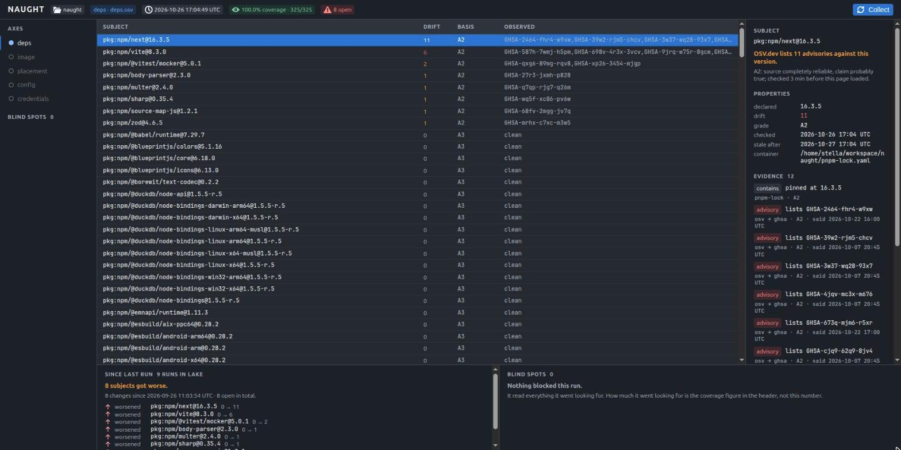

# Naught

> *Everything decays, even your software.*

Naught is a software supply chain observer that show you how decay your software systems.

## The problem

Software is not a static object. A running system is assembled from thousands of dependencies: 
packages, libraries, base images, configuration, certificates, credentials... 
Together they do the job, but each one is decaying, and they do not decay at the same speed:

- Certificates expire on 90 days. It is *Predictable.*
- Vulnerabilities arrive from nowhere. It is *Sudden.*
- Vendor libraries get abandoned. It is *Silent.*
- Configuration drifts. It is *Gradual.*

People points on a system and says "It works", but that says nothing about the health of a system. 
And because the whole is emergent, so is its collapse as a system when one thing went wrong.

An example: In 2016, eleven lines of JavaScript named `left-pad` were removed from `npm`, and builds broke around the world. 
But exceptionally, If your DevOps teams didn't set nightly builds, you won't see that coming.

## What Naught does

Naught is a read-only observer. It records what your systems are assembled from, and measures *drifts*: 
the distance between your source of truth and the current state that Naught is checking.

Naught measures *drifts* along several *axes*:

| Axis          | Declared state                                  | Observed state                                 | Drift indicates                                           | Status    |
|---------------|-------------------------------------------------|------------------------------------------------|-----------------------------------------------------------|-----------|
| Dependencies  | The package versions that your lock file pins   | What advisory sources report about them now    | Vulnerable, compromised, or abandoned packages            | Available |
| Base images   | The digest that a tag resolved to at build time | The digest that the same tag resolves to now   | The tag now points to a different image                   | Available |
| Placement     | The scheduling plan                             | The nodes where workloads run                  | Workloads running outside their planned placement         | Planned   |
| Configuration | The node state declared in your repository      | The current node state                         | Nodes whose configuration differs from the declared state | Planned   |
| Credentials   | The intended lifetime of a credential           | The time since the credential was last rotated | Credentials in use past their intended lifetime           | Planned   |

Drift values are comparable within an axis, but not across axes. Together, the values from all of them form a *drift vector*.

> [!NOTE]
> A drift value of `null` means that Naught observed the subject but could not compute a value. It does not mean that the drift is zero.

Naught raises a warning when a drift value crosses a threshold you set, or when new things appear but was not present in the previous run.

### Use cases

Naught answers questions such as:

- Which components does this system have right now?
- An upstream package or image changed. Which of your systems depend on it, directly or transitively?
- What changed in your systems, and when?
- Which components have degraded since the last review?

## Naught, watching Naught

Naught is built from the ecosystem it watches, so its first subject is itself.
The screenshot below is Naught's interface after a collection run against
Naught's own `pnpm-lock.yaml`, on 2026-10-26:

- **Coverage.** The run asked OSV about 325 packages and received an answer for
  all 325: coverage 100%, no blind spots.
- **Findings.** 8 of the 325 packages carry published advisories, 24 in total.
  The previous run, on 2026-09-26, found none. All 8 were pinned at the same
  versions then; the advisories were published between the two runs. Nothing
  in the repository changed to cause them.
- **Who is affected.** The worst is `next@16.3.5`, with 11 advisories: the
  framework that renders the screen in the screenshot. `body-parser@2.3.0` and
  `multer@2.4.0` sit beneath the API that served it the data. Naught found the
  decay in the code that found it.
- **Why Naught believes it.** The detail panel lists the evidence for
  `next@16.3.5`: each advisory is a claim from OSV whose original source is the
  GitHub Advisory Database, graded A2 (a completely reliable source; the claim
  probably true), with the date OSV made the claim. The answer is marked stale
  24 hours after the run, and the interface says so once it is.

This is the acceptance test in
[ARCHITECTURE §9](docs/explanation/ARCHITECTURE.md): if Naught cannot find the
rot in itself, it does not work. The snake eating its own tail is the point.

## What Naught not do

- **Remediate.** It does not patch, upgrade, restart, or roll back your system. You have to take actions on your own.
- **Mutate your system.** It only needs read-only roles & credentials.
- **Become a dependency.** Just Docker, or a k8s-like system, which is a basic on any IT system.
- **Storing data in unprocessable formats.** Everything Naught retains is plain files on disk.
- **Vendor-locked you:** You can remove Naught and everything keeps running as before.

## Principles

- **Inert.** Its own state is append-only files. Collectors write but no rewrites. 
Every database, index, and view is derived, and can be thrown away and rebuilt.

- **Compact.** Each collector is a thin, replaceable adapter small enough to read in one sitting. 
The data format of Naught is the durable contract, but you can expect its code is disposable.

- **Transparent.** Every conclusion shows where it came from.

- **Independent.** Naught stands on its own. It can be fed by a sibling tools if you have, but not requires any of them.

- **Zero hostage.** Remove it, and nothing of yours is lost.

- **Honest about blind spots.** What Naught cannot see is marked as `unknown`.

- **No verdict without coverage.** Every answer arrives with how much Naught actually look at.

## License

AGPL-3.0. See `LICENSE`.

